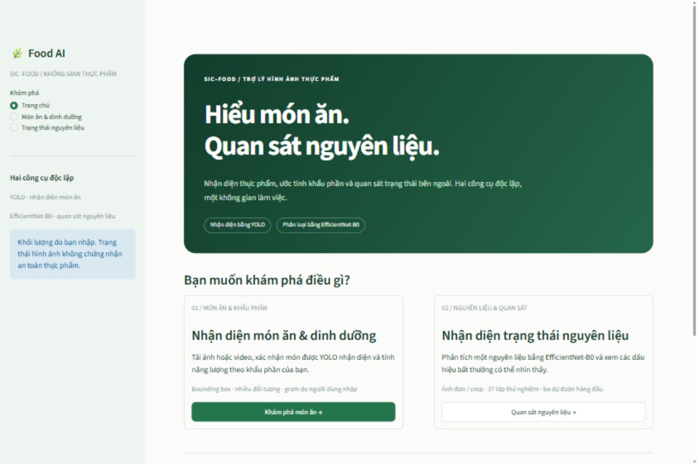
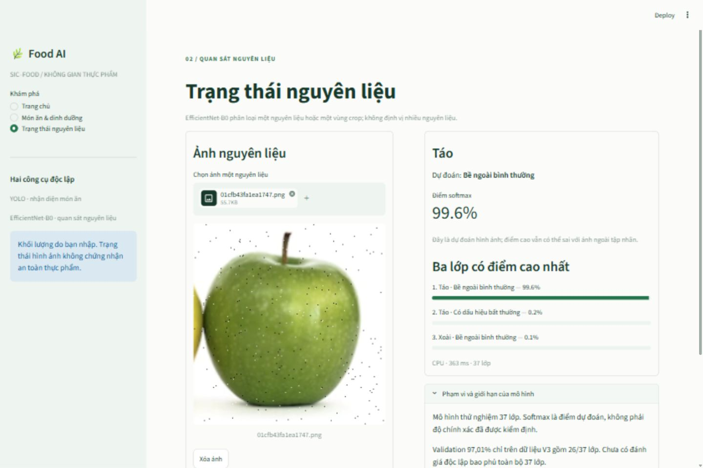
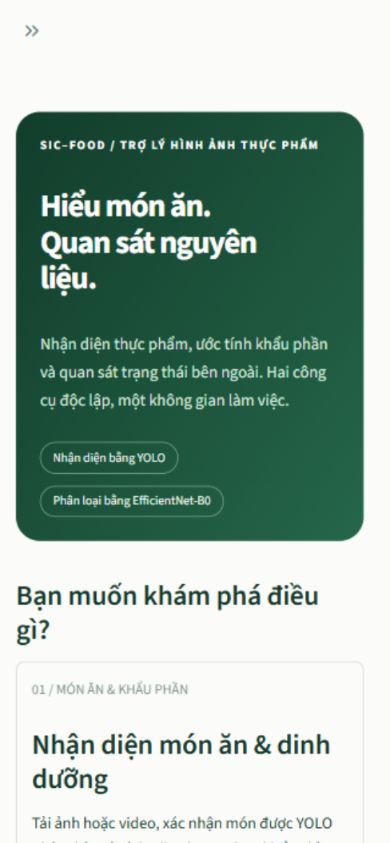

# Báo cáo hoàn thiện website Food AI — 17/10/2026

## Kết quả

Website Streamlit khởi động và chạy thực tế trên CPU. Hai module độc lập: YOLO nhận diện món ăn/khung hình video + Nutrition Engine; EfficientNet-B0 phân loại trạng thái một nguyên liệu/crop. Đã kiểm thử giao diện bằng trình duyệt với upload và checkpoint thật, ngoài unit/AppTest.

Không huấn luyện lại, không tải weights, không sửa dataset, notebook, checkpoint hoặc database. SHA256 của 16 file bảo vệ (weights, notebook và JSON dữ liệu/cấu hình) khớp bản trước sửa. Cấu hình phê duyệt Pork hiện có được giữ nguyên. Không có Git trong project/parent; đã tạo bản sao rollback tại backups/website_20261017_before.

## Khảo sát và tích hợp model

| Thành phần | Bằng chứng thực tế | Trạng thái |
| --- | --- | --- |
| YOLO | best.pt, task detect, DetectionModel, 214 nhãn | PASS, giữ conf=0,5 và NMS mặc định cũ; CPU |
| EfficientNet | efficientnet_b0_37_prototype.pth, model_state_dict, class_names, num_classes=37, epoch=15 | PASS, strict load, classifier [37,1280], eval/inference_mode |
| Preprocessing | Script feature cache dùng IMAGENET1K_V1.transforms() | EXIF → RGB → Resize 256 Bicubic → CenterCrop 224 → Normalize ImageNet |
| Nutrition Engine | 47 hồ sơ per_100g; nguồn food_items.json, unverified | Giữ công thức, kiểm tra trạng thái phù hợp, không điền số liệu thiếu |
| Cache | Hai lần gọi loader trả cùng object | PASS, cache theo path/mtime/size |
| Tính độc lập | page1/page2 không nạp EfficientNet; condition_page không gọi YOLO | PASS |
| Bảo toàn dữ liệu | protected_hashes.json trước/sau, 16 file | PASS |

Thứ tự 37 nhãn được lấy từ checkpoint, không hardcode. Parser nhận dấu __, hỗ trợ nguyên liệu có underscore và giữ tương thích nhãn nghiên cứu cũ. Định dạng checkpoint cũ vẫn nạp được bằng service offline; loader website yêu cầu 37 lớp.

## Kiểm thử đã chạy

| Kiểm tra | Kết quả |
| --- | --- |
| AST syntax 25 file Python root/tests; import 11 module; TOML/JSON config | PASS |
| unittest discover -s tests -p test_*.py | **51/51 PASS**, 10,208 giây |
| Test website sau cập nhật giới hạn upload | **10/10 PASS**, 8,307 giây |
| HTTP /_stcore/health | **200** |
| Checkpoint thật, output 37, tổng softmax ~1, class index, hữu hạn, CPU/cache | PASS |
| Checkpoint ở đường dẫn có khoảng trắng + tiếng Việt | PASS, bản sao tạm được dọn |
| YOLO ảnh thực tế images/test image.png | **5 box**: Waffle, Pasta, Banana, Avocado, Avocado |
| YOLO video thực tế images/test video.mp4, frame 0 | **2 box Orange**, chạy cả CLI và browser |
| EfficientNet mẫu Test V3 | 52 ảnh, 26 lớp, **48 khớp nhãn dataset**; không suy Accuracy toàn bộ 37 lớp |
| AppTest điều hướng/input/gram/ảnh mới/model lỗi/module độc lập/video frame | PASS, model và upload là mock rõ ràng |
| Browser upload ảnh YOLO → xác nhận chuối → nhập 150 g | **133,50 kcal**, biểu đồ hiển thị; ảnh và box giữ nguyên |
| Browser upload ảnh Táo Test V3 → EfficientNet | normal_appearance, **99,6% softmax**, Top-3 hiển thị |
| Browser file invalid.png chứa text | Báo lỗi thân thiện, xóa kết quả cũ, khóa nút phân tích; không lộ stack trace |
| Browser chuyển EfficientNet → YOLO | Giữ 150 g và 133,50 kcal |
| Browser desktop 1440×960 và mobile viewport 390×844 | PASS, bố cục xếp dọc ở màn hình nhỏ; documentWidth=390 |

Unit tests bao phủ RGB/alpha/grayscale/JPEG/WEBP, EXIF orientation, file lỗi, giới hạn byte/pixel, nhãn sai, NaN/Inf/output shape, model thiếu, tên tiếng Việt fallback, khối lượng 0/100/150/âm/không số, thiếu dữ liệu, giữ trạng thái và reset đúng input.

Một test Pork cũ ban đầu FAIL do lấy trạng thái phê duyệt từ cấu hình production đã thay đổi. Đã sửa fixture để bắt đầu với approved_mappings rỗng trong riêng test đó; không thay cấu hình của người dùng. Hai test nền dùng thư mục tạm và AppTest chạy ngoài sandbox vì giới hạn Windows; phiên AppTest trong sandbox bị treo đã dừng. Không bỏ kiểm tra để báo PASS.

Log có stack trace từ lỗi inference tổng hợp cố ý của test; UI chỉ nhận thông báo thân thiện. Browser có một thông báo kết nối đóng trong log server khi đổi phiên/viewport; các luồng đã xác nhận hoạt động sau đó, HTTP vẫn 200.

## Mẫu EfficientNet và hiệu năng

Chi tiết từng ảnh/nhãn/điểm/thời gian: [website_condition_samples.csv](website_condition_samples.csv).

- Chọn xác định hai ảnh mỗi lớp từ Test V3, không chọn ảnh Train.
- Dữ liệu chỉ bao phủ 26 lớp, nhãn dựa trên dataset sẵn có, không tái gán nhãn độc lập.
- Nhầm trong mẫu: carrot normal → apple defect; carrot defect → carrot normal; hai tomato defect → bell_pepper defect.
- Trung bình inference CPU trên 52 ảnh khoảng **43 ms/ảnh**, không gồm tải model. Một lần web đầu tiên khoảng 363 ms.
- YOLO từ browser, gồm lần đầu tải model, khoảng 5,12 giây cho ảnh mẫu. Không phải cam kết hiệu năng trên mọi máy/ảnh.
- 97,01% là kết quả Validation V3 26 lớp trong lịch sử training, không phải Accuracy đã xác minh cho 37 lớp.
- Không dùng 48/52 làm Accuracy đại diện vì đây là tập chẩn đoán nhỏ, chọn xác định, có khả năng các ảnh cùng nguồn.

Thông tin nhãn model đầy đủ và metadata: [website_model_checks.json](website_model_checks.json).

## Các file sửa

| File | Thay đổi |
| --- | --- |
| main.py | Trang chủ, điều hướng 3 trang, bỏ menu IMAGE/VIDEO cũ |
| page1.py | YOLO ảnh + xác nhận dinh dưỡng, không tự gọi EfficientNet |
| page2.py | Giữ nhận diện frame video, preview, giới hạn index, không tự gọi EfficientNet |
| model_loader.py | Checkpoint 37 mặc định, CPU/cache, kiểm tra task và thông báo model thiếu |
| condition_service.py | Format fast-track, preprocessing đúng training, softmax/Top-3, kiểm tra đầu ra |
| detection_service.py | CPU, khóa inference khi dùng cache chung, giữ mọi box |
| pipeline_config.py | Parse ingredient__appearance và giữ parser nhãn cũ |
| nutrition_service.py | Giữ công thức; chặn boolean giả khối lượng/giá trị dinh dưỡng |
| README.md | Hướng dẫn website mới, Windows/Anaconda/Jupyter, kiến trúc và giới hạn |
| requirements.txt | Streamlit >=1.65,<2 cho API giao diện đã kiểm tra; không cài lại dependency |
| tests/test_two_model_pipeline.py | Video mặc định độc lập, không tự tạo condition_assessment |
| tests/test_bulk_state_dataset.py | Fixture Pork không phụ thuộc phê duyệt production |
| tests/ui_harness.py | Mock upload/model rõ ràng, chạy main.py thật |
| tests/video_ui_harness.py | Entry tương thích tới harness mới |
| tests/check_streamlit.py | Chạy NavigationUITests |
| tests/check_image_ui.py | Chạy FoodStateUITests |
| tests/check_video_ui.py | Chạy VideoUITests |

## Các file thêm

- condition_page.py: giao diện EfficientNet riêng.
- image_service.py: đọc/chuẩn hóa/giới hạn ảnh.
- app_state.py: state bền qua navigation; widget không giữ bản duy nhất của dữ liệu.
- ui_components.py: tên Việt, style scoped, thẻ dinh dưỡng/biểu đồ.
- .streamlit/config.toml: theme xanh/trắng, giới hạn upload, toolbar tối giản, ẩn lỗi nội bộ.
- tests/test_website.py: bảy unit test mới.
- tests/test_website_ui.py: ba test AppTest nhiều bước.
- tests/check_website_models.py: kiểm thử model thật và xuất báo cáo.
- tests/fixtures/invalid.png: text fixture cố ý không phải ảnh.
- docs/website_implementation_plan.md và báo cáo này.
- Báo cáo/screenshot: website_model_checks.json, website_condition_samples.csv, website_yolo_sample.jpg, website_home_desktop.png, website_home_mobile.png, website_condition_desktop.png, website_condition_mobile.png.

Cấu trúc cây và cách chạy: [README.md](../README.md).

## Những giới hạn còn lại / việc cần người dùng

- Không còn lỗi chức năng chặn các luồng đã kiểm thử. Việc kiểm thử không bao phủ mọi thiết bị/trình duyệt hoặc mọi ảnh thực tế; mobile được kiểm tra bằng viewport, không phải điện thoại thật.
- Vẫn cần đánh giá độc lập toàn bộ 37 lớp, xác minh nhãn mới và hiệu chỉnh ngưỡng. Website là prototype theo metadata checkpoint.
- Chưa có phân lớp tôm hoặc broccoli bất thường. Chưa có detector/OOD cho mọi nguyên liệu trong ảnh; không nối YOLO món ăn để giả lập detection nguyên liệu.
- 47 hồ sơ dinh dưỡng còn unverified/unknown preparation. Cần người dùng cung cấp dữ liệu có nguồn kiểm chứng để mở rộng; không tự sửa database.
- Nội dung ứng dụng bằng tiếng Việt; một số nhãn điều khiển do Streamlit/Vega/browser cung cấp (Upload, thao tác biểu đồ/video) giữ ngôn ngữ mặc định của framework. Không sửa mã package hoặc dùng CSS thay chữ để tránh hỏng widget.
- Dữ liệu phiên lưu RAM; reload tab hoặc restart server có thể mất phiên. Không có lịch sử tài khoản/database mới.
- Không cần thao tác model thủ công để chạy trên máy hiện tại. Khi chuyển máy, mang đúng hai checkpoint và môi trường tương thích; khởi động theo README.
- Bản backup chỉ phục hồi mã; giữ checkpoint/dataset gốc. Không dùng git reset/clean, không tạo repo/commit mới.

## Ảnh chụp kiểm chứng

